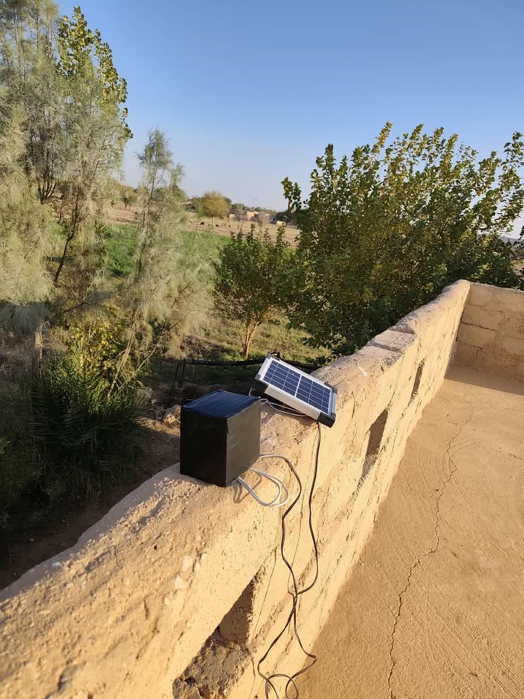
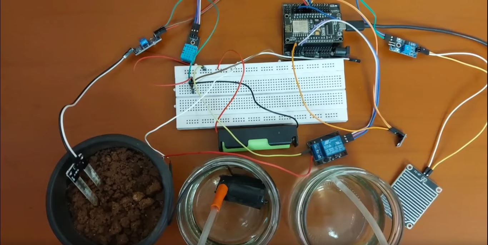
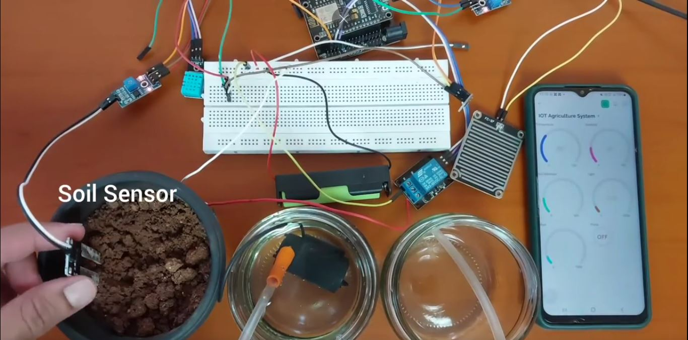
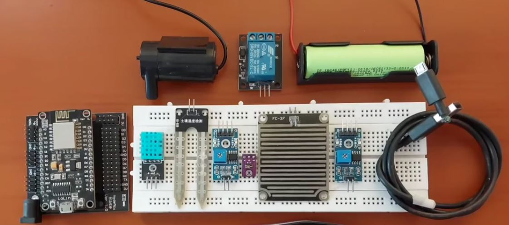
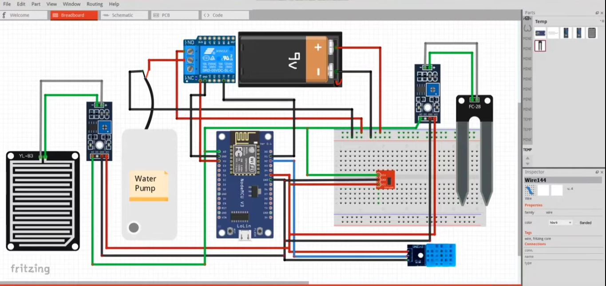
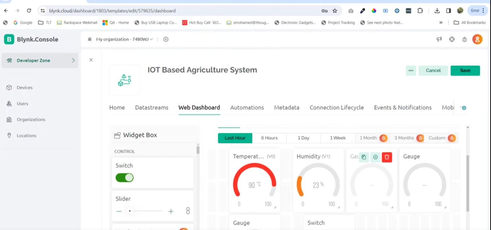

# IOT Smart Farm

Smart greenhouse monitoring, drip irrigation and heating automation, visual smoke/fire detection, and farmer alert system designed for field conditions in Syria using solar-powered `ESP32-CAM` edge nodes, backbone relay nodes (local network, local server, or SIM module), a server backend, and a mobile application.

## Repository Notice — Private / Proprietary Source Code

This repository structure documents the system architecture and module layout for **IOT Smart Farm**.

**Source code, firmware implementations, server logic, and mobile application files are intentionally left empty in this view because they are private/proprietary and are not published publicly.**

# IoT Smart Farm — Project Gallery

An end-to-end smart greenhouse monitoring, automated drip irrigation, climate control, and visual smoke/fire detection system engineered for agricultural field conditions in Syria[cite: 1]. The architecture integrates solar-powered `ESP32-CAM` edge nodes, resilient backbone relay gateways, a centralized backend server, and a mobile application[cite: 1].

---

## 📸 System Visual Gallery

Explore the physical deployment, circuit prototyping, and software dashboards below:

### 1. Real Field Deployment

> **Field Overview:** The fully assembled system deployed in the actual agricultural field environment. The sensitive electronic circuitry and hardware components are protected inside a custom **3D-printed (3D-plotted) weatherproof enclosure** designed for long-term outdoor durability.

### 2. Circuit Prototyping & Sensor Integration
| Breadboard Assembly | Soil Sensor Testing |
| :---: | :---: |
| [cite: 3] | [cite: 4] |
| *Initial wiring setup connecting the microcontroller, relays, power supply, and environmental sensors.* | *Calibrating and testing soil moisture sensors inside test pots alongside water reservoirs.* |

### 3. Hardware Layout & Wiring
| Component Layou | Fritzing Schematic |
| :---: | :---: |
| [cite: 5] | [cite: 6] |
| *Top-down view of the physical components, breadboard layout, and power modules.* | *Detailed electrical schematic mapping out pin connections and system power distribution.* |

### 4. Control & Telemetry Dashboard
[cite: 2]
> **Cloud Interface:** The Blynk web dashboard used for tracking real-time telemetry (temperature gauges, humidity levels) and sending remote commands to system actuators[cite: 1, 2].

## Overview of Planned Modules

- `docs/` — Architecture notes, wiring guides, local-vs-SIM connectivity behavior, and smoke/fire detection documentation.
- `hardware/` — Bill of materials (BOM), schematics, and weatherproof enclosure notes.
- `firmware/edge-node/` — Solar-powered `ESP32-CAM` field node for sensors (temperature, humidity, light, rain), periodic imaging, smoke/fire detection, local networking, and pump/heater actuation.
- `firmware/backbone-node/` — Relay/gateway node bridging local field nodes to a Local Server or the internet via a SIM module with offline buffering.
- `server/` — Backend API, automation rules, alert/image handling, database storage, and web dashboard.
- `mobile-app/` — Farmer mobile interface for live readings, camera snapshots, alerts, and pump/heater control.
- `simulators/` — Simulation utilities for testing without physical hardware.
